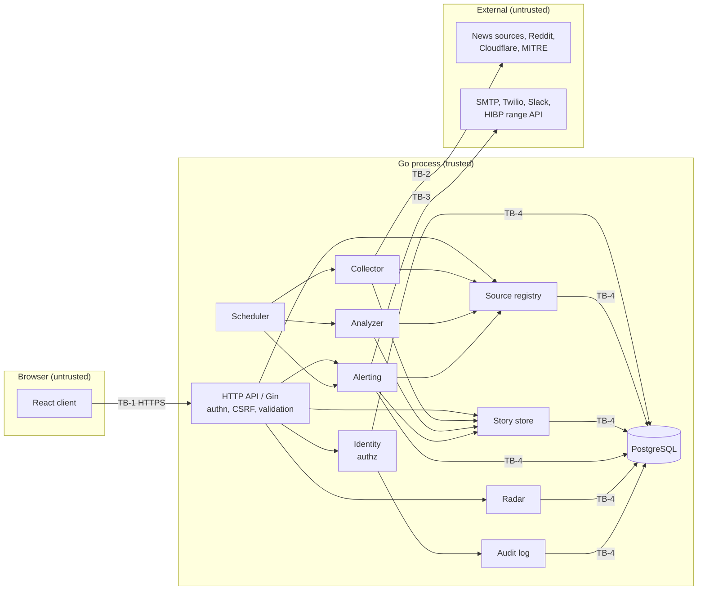

# Architecture: Good Morning Breach

This file owns HOW the system is built: its components, boundaries, technology, and data flow. `REQUIREMENTS.md` owns WHAT the system does. `DESIGN.md` owns how it looks. `SECURITY.md` owns the detailed controls. Nothing is built yet.

Versions were checked against official sources on 2026-11-13: go.dev/doc/devel/release, github.com/gin-gonic/gin/releases, react.dev/versions, vite.dev/releases, and nodejs.org/en/about/previous-releases.

## Required Architecture Inputs

- **Requirements and design sources:** `REQUIREMENTS.md` (FR-1 to FR-10, NFR-1 to NFR-4); `DESIGN.md`; `reports/Licensed cyber news sources.md`.
- **Target surfaces:** a web dashboard; background jobs for collection, analysis, the morning alert, and retention. Public APIs: none.
- **Runtime and deployment environment:** CONFIRMED (AQ-1): a single machine owned by the owner, for the owner only. The server listens on localhost only and uses a local TLS certificate (NFR-3.1). Alerts at 07:00 need that machine to be on and awake. Because availability is best effort (NFR-4.1), this is accepted. Dashboard links in text messages (FR-4.13) only open on this machine. Accounts beyond the owner's are supported (NFR-2.1) but can only be used on this machine.
- **Server framework:** Go with Gin (explicit choice).
- **Client frameworks:** ReactJS (explicit choice), built as a single-page app and served by the Go server. Serving it from the Go server is PROPOSED.
- **API style:** a private JSON-over-HTTPS API used only by the bundled client. It is not a public API. PROPOSED, because it is the simplest fit for a React client and a Gin server.
- **Authentication and session model:** email, password, and TOTP (FR-6.5). A server-side session referenced by a cookie, with a 30-minute idle timeout (FR-6.10). The server-side session is PROPOSED.
- **Outbound calls:** collection sources, MITRE, SMTP, Twilio, Slack webhooks, and the HIBP range API. There are no inbound connections from outside the machine.
- **Authorization model:** two roles, admin and user (FR-6.4), plus ownership checks on per-user settings (FR-6.12). Enforced in the server only.
- **Data store and expected scale:** PostgreSQL, one local instance on the same machine (CONFIRMED, AQ-2). Scale: at least 10 accounts (NFR-2.1) and 365 days of stories (FR-10.1). Story volume per day is UNKNOWN.
- **Logging library or platform logger:** Go standard library `log/slog`.
- **Security expectations:** owned by `SECURITY.md`. This file only names the enforcement points.

## Stack

| Technology | Version line | Justification | Status |
|---|---|---|---|
| Go | 1.27.x (1.27.4 current; supported until Go 1.29 is released) | Explicit choice: server. Includes `net/http`, `crypto`, `html/template`, `log/slog`, `net/smtp`, and `time`, which cover HTTP clients, email bodies (FR-4.12, NFR-3.4), logging, and scheduling without extra packages. | CONFIRMED |
| Gin (`github.com/gin-gonic/gin`) | v1.12.x (minimum Go 1.24) | Explicit choice: HTTP routing and middleware for the dashboard API. | CONFIRMED |
| React + React DOM | 19.3.x | Explicit choice: dashboard client (FR-5). | CONFIRMED |
| Node.js | 26.x LTS (build machine only, not at runtime) | Needed to build the React client. It does not run in production. | PROPOSED: the current LTS line. |
| Vite | 8.3.x | Builds and bundles the React client. React has no build tool of its own. | PROPOSED: the standard React build tool. |
| TypeScript | 7.0.x | Type-checks the client and its API contracts, so mistakes in rendering untrusted data are caught at build time. | CONFIRMED (AQ-7, delegated decision) |
| PostgreSQL | 18.x (18.7 current; supported until 2030-11-14) | Stores stories, sources, accounts, settings, and records (FR-1 to FR-10). Its built-in full-text search covers keyword search (FR-5.5) without a separate search engine. | CONFIRMED (AQ-2) |
| `github.com/jackc/pgx/v5` | v5.11.x (minimum Go 1.25) | PostgreSQL driver. The Go standard library has no PostgreSQL driver. | PROPOSED: the most widely used maintained Go driver. |
| `golang.org/x/crypto` (argon2id) | latest tagged | Password hashing (FR-6.5). The Go standard library has no memory-hard password hash. | PROPOSED |
| `github.com/pquerna/otp` | version TO BE DECIDED | TOTP enrolment and checks (FR-6.5, FR-6.15). Not in the Go standard library. | PROPOSED |
| `github.com/mmcdole/gofeed` | version TO BE DECIDED | Parses RSS, Atom, and JSON feeds from the FR-1.14 sources. Writing three feed parsers by hand would add more risk than one dependency. | PROPOSED |
| MITRE ATT&CK Enterprise STIX bundle | version TO BE DECIDED | Technique IDs, names, tactics, and links (FR-1.4, FR-7). This is a data file, not a package. | CONFIRMED (required) |
| Email delivery | The owner's personal mail account over SMTP with STARTTLS or TLS and an app password. The provider is UNKNOWN. | Morning alerts and password reset (FR-4.2, FR-6.9). Go's `net/smtp` is the client, so no extra package is needed. | CONFIRMED (AQ-4) |
| SMS delivery: Twilio Programmable Messaging REST API | 2010-04-01 API | Text alerts and phone verification codes (FR-4.3, FR-4.15). Called with the standard `net/http` client, with no SDK. US numbers need toll-free or A2P 10DLC registration. | CONFIRMED (AQ-5, delegated decision) |
| Slack incoming webhooks | Slack platform | Slack alerts (FR-4.4, FR-4.16). Uses the standard `net/http` client with no SDK. | CONFIRMED (required) |
| HIBP Pwned Passwords range API | v3 range API | FR-6.6. Uses k-anonymity: only the first 5 hex characters of the password's SHA-1 leave the machine, with the `Add-Padding` header. If the API is unreachable, the password is refused and the user is told to try again later (fails closed). A local copy of the full list (about 40 GB) is too large for a personal tool. | CONFIRMED (AQ-6, delegated decision) |
| Vitest | version TO BE DECIDED | Client unit tests. It shares Vite's configuration. | PROPOSED |

The client does not use a router, a state library, or a UI kit. The four screens in `DESIGN.md` can use React state and URL fragments. If they turn out not to be enough, that becomes a new AQ.

## Components and Flows

All components run in **one Go process** that uses one local PostgreSQL database (AQ-2). The single process is PROPOSED: it is the fewest services that can meet NFR-2 at a scale of 10 users.

| Component | Responsibility | Business rules enforced | Data owned | Requirement IDs | Status |
|---|---|---|---|---|---|
| Web client (React) | Shows the screens. Holds no authority. | None. It only displays what the server allows. | None | FR-5, DESIGN.md | SUPPORTED |
| HTTP API (Gin) | Transport: routes, sessions, CSRF, input parsing, mapping errors to responses | Authentication gate on every route; role and ownership checks done by calling Identity | None | FR-6.1, FR-6.2, NFR-3.1 | SUPPORTED |
| Identity | Accounts, roles, login, TOTP, lockout, password reset, sessions | FR-6.3 to FR-6.15; FR-9.1 to FR-9.5; FR-9.7 | Accounts, roles, credential hashes, TOTP secrets, sessions, reset tokens | FR-6, FR-9 | SUPPORTED |
| Audit log | Records admin actions and lets admins read them | Append-only | Admin action records | FR-9.6 | SUPPORTED |
| Source registry | Sources, license records, content rights | FR-1.5, FR-1.6, FR-1.15, FR-1.16, FR-8.1 to FR-8.3, FR-8.8, FR-8.9 | Sources, license records, source status | FR-8 | SUPPORTED |
| Collector (job) | Fetches each enabled source on its schedule. Normalizes and de-duplicates items. Handles Reddit removals. | FR-1.8 to FR-1.12, FR-1.17, FR-1.18, FR-1.20, FR-1.21; records failures | Raw collection results, failure records | FR-1, FR-8.6, FR-8.7 | SUPPORTED |
| Analyzer (job) | Assigns categories, sentiment, risk, ATT&CK tags, summaries, and CVE links | FR-2.1 to FR-2.6, FR-3, FR-7.1, FR-1.13; skips Reddit text; no summary where FR-8.9 forbids one | Category, sentiment, risk, and tag assignments | FR-2, FR-3, FR-7 | SUPPORTED: local rules (AQ-3) |
| Story store | Stories, the sources that reported them, related links, query and search | FR-1.12, FR-5.3 to FR-5.5, FR-10.1 | Stories | FR-5, FR-10 | SUPPORTED |
| Radar | Cloudflare Radar outages, attacks, and BGP events | FR-1.19, FR-5.6 | Radar snapshots | FR-1.2, FR-1.19 | SUPPORTED |
| Alerting (job) | Per-user schedule, story selection, rendering, delivery, retries | FR-4.5 to FR-4.19; FR-8.8 and FR-8.11 on every channel | Alert settings, delivery records | FR-4, FR-10.2 | SUPPORTED |
| Channel adapters | Email, SMS, and Slack transport only | None | None | FR-4.2 to FR-4.4 | SUPPORTED |
| Scheduler | Starts collection, analysis, alert, and retention runs in-process | FR-1.9 (collect before alerts), NFR-2.2 | None | FR-1.8, FR-4.5, FR-10 | SUPPORTED |
| Retention (job) | Deletes expired stories and delivery records | FR-10.1, FR-10.2 | None | FR-10 | SUPPORTED |

### Main data flows

1. **Collect:** Scheduler → Collector → source (HTTPS) → Collector validates and normalizes → Story store. Failures go to source status.
2. **Analyze:** Story store → Analyzer (with ATT&CK data and the source's content rights) → Story store.
3. **Read:** browser → HTTP API (session check) → Identity (role and ownership) → Story store, Radar, or Source registry → JSON → React renders it as text.
4. **Alert:** Scheduler → Alerting selects stories for the user → renders per channel, applying content rights → channel adapter → provider. Each attempt goes to delivery records.
5. **Administer:** browser → HTTP API → Identity (admin check) → Source registry or Identity → Audit log.

### Trust boundaries and enforcement points

- **TB-1 Browser ↔ HTTP API.** Authentication, CSRF protection, and the session idle timeout are enforced in HTTP API middleware. Request validation happens at the API edge. Authorization (role and ownership) happens in Identity, called by every handler. The client is never trusted.
- **TB-2 External sources → Collector.** All collected data is untrusted (NFR-3.4). The Collector validates size, type, and URL scheme on intake. Output encoding happens at render time: React escapes text, and email bodies use `html/template`. Slack text is escaped before sending.
- **TB-3 Server → delivery providers (SMTP, Twilio, Slack) and the HIBP range API.** Outbound only. Slack webhook URLs are validated against the Slack incoming-webhook format when saved (FR-4.16). Provider credentials stay on the server.
- **TB-4 Process ↔ PostgreSQL and secrets on disk.** PostgreSQL listens on localhost only. The app connects with a least-privilege role that does not own the schema (PROPOSED). Only the server process reads the secrets. Secrets at rest are owned by `SECURITY.md`.
- **TB-5 Operator ↔ installation.** The first admin is created at install time (FR-9.7) through a local setup step, not through the web.

**Analysis method (CONFIRMED, AQ-3).** The Analyzer runs local rules only, and no collected content leaves the machine. Rules combine keyword and pattern matching on the title and permitted text, structured feed fields (CVSS, CISA KEV membership, EPSS, CVE IDs, vendor advisory severity), and the names and aliases in the MITRE ATT&CK bundle. The Analyzer generates no free-text summaries. Where FR-8.8 permits "system summary" or "verbatim excerpt", the "short summary" shown (FR-4.12, FR-5.2) is a truncated verbatim excerpt. Where only "headline and link" is permitted, no summary is shown. This satisfies FR-8.9 by construction. The exact rules are TO BE DECIDED in later steps.

## Dependency Rules

- **DR-1** Dependencies point one way: Web client → HTTP API → domain components (Identity, Source registry, Story store, Analyzer, Alerting, Radar, Audit log) → storage and channel adapters. Nothing points back, and there are no cycles.
- **DR-2** Business rules live only in domain components. They never live in Gin handlers, React code, the SQL layer, or channel or source adapters.
- **DR-3** Each component writes only the data it owns (see the table). Other components use its interface to read or change that data.
- **DR-4** Every content-rights decision (FR-8.8, FR-8.9, FR-1.17, FR-1.20, FR-1.21) goes through one Source registry function, used by the dashboard API and every alert channel.
- **DR-5** Vendor code (Gin, pgx, feed parser, SMS and SMTP providers, Slack) is wrapped in adapters, so domain code never imports it directly.
- **DR-6** The client receives only data the server already authorized and filtered. It never receives secrets, webhook URLs, or hashes (NFR-3.3).
- **DR-7** Jobs (Collector, Analyzer, Alerting, Retention) call domain components. They do not call the HTTP API.

## Diagrams

## Toolchain

| Check | Command | Notes |
|---|---|---|
| Install (server) | `go mod download` | PostgreSQL 18 is installed separately, for example with `brew install postgresql@18` |
| Install (client) | `npm ci --ignore-scripts` | Uses Node 26 LTS; scripts disabled per SC-091 |
| Build (client) | `npm run build` (runs `vite build`) | The output is embedded into the Go binary (PROPOSED) |
| Build (server) | `go build ./...` | |
| Type-check (server) | `go vet ./...` | The compiler type-checks during the build |
| Type-check (client) | `tsc --noEmit` | |
| Test (server) | `go test -race ./...` | |
| Test (client) | `npx vitest run` | |
| Dependency audit (server) | `govulncheck ./...` | Install it with `go install golang.org/x/vuln/cmd/govulncheck@latest` |
| Dependency audit (client) | `npm audit --omit=dev`; `npm audit signatures` | Signatures check per SC-091 |
| Dependency verify (server) | `go mod verify` | Per SC-091 |
| Lint | `go vet ./...` (server). Client: N/A, because `tsc --noEmit` and React's default escaping cover the required checks. | A separate linter is not required by the inputs *(delegated decision)* |

## Open Questions

None. In the interview, the owner answered AQ-1 to AQ-4. The owner then told the author to answer the rest. AQ-5, AQ-6, and AQ-7 were decided on that instruction and are marked *(delegated decision)* in the Stack table. These details are still UNKNOWN and will be settled when building:
- which mail provider the owner uses for SMTP
- the exact pinned versions of the PROPOSED Go and npm packages
